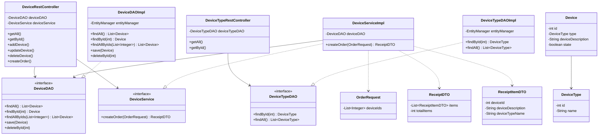

# HardTrack - Documentación Detallada para Estudiantes

## Índice
- [1. Visión General](#1-visión-general)
- [2. Arquitectura del Proyecto](#2-arquitectura-del-proyecto)
- [3. Relación entre Clases](#3-relación-entre-clases)
- [4. Entidades (Modelo de Dominio)](#4-entidades-modelo-de-dominio)
- [5. DTOs (Data Transfer Objects) - ¿Por qué usarlos?](#5-dtos-data-transfer-objects---por-qué-usarlos)
- [6. Capa DAO (Acceso a Datos)](#6-capa-dao-acceso-a-datos)
- [7. Capa de Servicios - ¿Por qué usar servicios?](#7-capa-de-servicios---por-qué-usar-servicios)
- [8. Capa REST (Controladores)](#8-capa-rest-controladores)
- [9. Seguridad con Spring Security](#9-seguridad-con-spring-security)
- [10. Manejo de Excepciones](#10-manejo-de-excepciones)
- [11. Configuración y Propiedades](#11-configuración-y-propiedades)
- [12. Flujo Completo de una Petición](#12-flujo-completo-de-una-petición)
- [13. Cómo Ejecutar el Proyecto](#13-cómo-ejecutar-el-proyecto)
- [14. Referencias Cruzadas (Comentarios enlazados)](#14-referencias-cruzadas-comentarios-enlazados)

---

## 1. Visión General

HardTrack es una API REST para la gestión de dispositivos (dispositivos tecnológicos/informáticos). Permite:
- Listar, consultar, crear, actualizar y borrar dispositivos (`/api/devices`)
- Listar y consultar tipos de dispositivos (`/api/device-types`)  
- Crear pedidos/órdenes de dispositivos mediante `/api/devices/order`, que valida disponibilidad, marca dispositivos como no disponibles y genera un recibo (receipt)

Ver documentación también en: [data/DOCUMENTACION_HARDTRACK.md](data/DOCUMENTACION_HARDTRACK.md)

---

## 2. Arquitectura del Proyecto

El proyecto sigue una arquitectura en capas típica de Spring Boot:

```
┌─────────────────────────────────────────────────────────┐
│                    Cliente HTTP                          │
└─────────────────────────┬─────────────────────────────────┘
                          │
┌─────────────────────────▼─────────────────────────────────┐
│                REST Controllers (rest/)                   │
│  - DeviceRestController, DeviceTypeRestController         │
└─────────────────────────┬─────────────────────────────────┘
                          │
                    ┌─────▼─────┐
                    │ Servicios  │  (service/ + service/impl/)
                    │ Lógica de  │  Reglas de negocio, transacciones
                    │ negocio    │
                    └─────┬─────┘
                          │
                    ┌─────▼─────┐
                    │    DAO     │  (dao/) Acceso a datos con EntityManager
                    │ Data Access│
                    └─────┬─────┘
                          │
                    ┌─────▼─────┐
                    │  Entidades │  (entity/) JPA/Hibernate
                    │  (JPA)     │  Mapeo objeto-relacional
                    └─────┬─────┘
                          │
                    ┌─────▼─────┐
                    │   MySQL    │  Base de datos
                    └───────────┘
```

**Capas transversales:**
- `security/` - Configuración de Spring Security
- `dto/` - Objetos para transferencia de datos entre capas/cliente
- `exception/` - Excepciones personalizadas y manejador global

---

## 3. Relación entre Clases

### Diagrama de relaciones principal



**Relaciones clave:**
- `Device` tiene `@ManyToOne` con `DeviceType` (muchos dispositivos pueden ser del mismo tipo)
- Los controladores dependen de DAO/Service por inyección (`@Autowired`)
- `DeviceServiceImpl` implementa la lógica transaccional para crear pedidos
- Los DTOs desacoplan la representación interna (entidades JPA) de lo que se envía/recibe en la API

---

## 4. Entidades (Modelo de Dominio)

### Device (`entity/Device.java`)
Representa un dispositivo físico en la base de datos.

```java
@Entity
@Table(name = "device")
public class Device {
    @Id
    @GeneratedValue(strategy = GenerationType.IDENTITY)
    @Column(name = "id")
    private int id;

    @ManyToOne
    @JoinColumn(name = "id_type", nullable = false)
    private DeviceType type;

    @Column(name = "device_description")
    private String deviceDescription;

    @Column(name = "state")  // true = disponible, false = no disponible
    private boolean state;
    ...
}
```

**Explicación:**
- `@Entity` marca la clase como entidad JPA
- `@Table(name = "device")` mapea a la tabla `device`
- `@Id` + `@GeneratedValue(strategy = GenerationType.IDENTITY)` indica clave primaria autoincremental
- `@ManyToOne` con `@JoinColumn(name = "id_type")` establece relación con `DeviceType`
- `state` controla disponibilidad (crítico para la lógica de pedidos)

### DeviceType (`entity/DeviceType.java`)
Categoría/tipo de dispositivo.

```java
@Entity
@Table(name = "device_type")
public class DeviceType {
    @Id
    @GeneratedValue(strategy = GenerationType.IDENTITY)
    @Column(name = "id")
    private int id;
    
    @Column(name = "name")
    private String name;
    ...
}
```

---

## 5. DTOs (Data Transfer Objects) - ¿Por qué usarlos?

Los DTOs son objetos planos usados para **transferir datos** entre cliente y servidor, o entre capas, sin exponer directamente las entidades JPA.

### ¿Por qué es necesario usar DTOs?

1. **Desacoplamiento**: Las entidades JPA pueden tener relaciones complejas, lazy loading, o campos que no queremos exponer
2. **Seguridad**: Evitamos exponer estructura interna de la base de datos
3. **Flexibilidad**: Podemos dar forma personalizada a la respuesta (ej. `ReceiptDTO` con `deviceTypeName` en lugar de objeto completo)
4. **Validación/Contrato claro**: Define explícitamente qué se espera recibir/enviar
5. **Rendimiento**: Controlamos qué datos se serializan

### DTOs del proyecto

#### OrderRequest (`dto/OrderRequest.java`)
```java
public class OrderRequest {
    private List<Integer> deviceIds;
    ...
}
```
**Uso:** Petición POST a `/api/devices/order` para solicitar varios dispositivos. Solo envía IDs, no objetos completos.

#### ReceiptDTO (`dto/ReceiptDTO.java`)
```java
public class ReceiptDTO {
    private List<ReceiptItemDTO> items;
    private int totalItems;
    ...
}
```
**Uso:** Respuesta tras crear un pedido exitoso. Contiene el resumen del pedido.

#### ReceiptItemDTO (`dto/ReceiptItemDTO.java`)
```java
public class ReceiptItemDTO {
    private int deviceId;
    private String deviceDescription;
    private String deviceTypeName;
    ...
}
```
**Uso:** Detalle de cada dispositivo en el recibo. Extrae `deviceTypeName` desde la entidad relacionada (`device.getType().getName()`).

**Observación importante:** En `DeviceServiceImpl.createOrder()`, al crear el recibo se hace:
```java
String typeName = device.getType() != null ? device.getType().getName() : null;
items.add(new ReceiptItemDTO(device.getId(), device.getDeviceDescription(), typeName));
```
Esto evita serializar toda la entidad `DeviceType` y da un formato limpio al cliente.

---

## 6. Capa DAO (Acceso a Datos)

Los DAO (Data Access Objects) encapsulan el acceso a la base de datos. Aquí se usa **EntityManager** de JPA directamente (patrón DAO tradicional con JPA).

### Interfaces
- `DeviceDAO` - Contrato para operaciones con dispositivos
- `DeviceTypeDAO` - Contrato para operaciones con tipos

### Implementaciones

#### DeviceDAOImpl (`dao/DeviceDAOImpl.java`)
```java
@Repository
public class DeviceDAOImpl implements DeviceDAO {
    private EntityManager entityManager;
    
    @Autowired
    public DeviceDAOImpl(EntityManager entityManager) {
        this.entityManager = entityManager;
    }
    
    @Override
    public List<Device> findAll() {
        TypedQuery<Device> query = entityManager.createQuery("from Device", Device.class);
        return query.getResultList();
    }
    
    @Override
    public Device findById(int id) {
        return entityManager.find(Device.class, id);
    }
    
    @Override
    public List<Device> findAllByIds(List<Integer> ids) {
        if (ids == null || ids.isEmpty()) {
            return List.of();
        }
        TypedQuery<Device> query = entityManager.createQuery("from Device d where d.id in :ids", Device.class);
        query.setParameter("ids", ids);
        return query.getResultList();
    }
    
    @Override
    @Transactional
    public void save(Device device) {
        entityManager.merge(device);
    }
    
    @Override
    @Transactional
    public void deleteById(int id) {
        Device device = entityManager.find(Device.class, id);
        if (device != null) {
            entityManager.remove(device);
        }
    }
}
```

#### DeviceTypeDAOImpl (`dao/DeviceTypeDAOImpl.java`)
Similar al anterior, operaciones básicas con EntityManager.

**Aspectos importantes:**
- `@Repository` indica componente DAO y permite traducción de excepciones JPA
- Se inyecta `EntityManager` (gestionado por Spring/Hibernate)
- `save()` usa `merge()` - funciona tanto para insertar como actualizar
- `@Transactional` en `save()` y `deleteById()` asegura operaciones atómicas a nivel DAO
- `findAllByIds()` usa consulta JPQL con `IN` para buscar múltiples dispositivos eficientemente

---

## 7. Capa de Servicios - ¿Por qué usar servicios?

### ¿Por qué es necesario usar servicios?

1. **Separación de responsabilidades**: Los controladores no deben contener lógica de negocio
2. **Transaccionalidad**: Las operaciones complejas (como crear un pedido) deben ejecutarse en una transacción
3. **Reutilización**: La lógica puede ser usada por múltiples controladores
4. **Mantenibilidad**: Más fácil de testear y modificar reglas de negocio
5. **Orquestación**: Coordina múltiples llamadas DAO, validaciones, cálculos

### DeviceService (`service/DeviceService.java`)
```java
public interface DeviceService {
    ReceiptDTO createOrder(OrderRequest orderRequest);
}
```

### DeviceServiceImpl (`service/impl/DeviceServiceImpl.java`)
```java
@Service
public class DeviceServiceImpl implements DeviceService {

    private DeviceDAO deviceDAO;

    @Autowired
    public DeviceServiceImpl(DeviceDAO deviceDAO) {
        this.deviceDAO = deviceDAO;
    }

    @Override
    @Transactional
    public ReceiptDTO createOrder(OrderRequest orderRequest) {
        // 1. Validación: request no nulo y con IDs
        if (orderRequest == null || orderRequest.getDeviceIds() == null || orderRequest.getDeviceIds().isEmpty()) {
            throw new InvalidOrderException("No device ids provided");
        }

        List<Integer> ids = orderRequest.getDeviceIds();
        List<Device> devices = deviceDAO.findAllByIds(ids);

        // 2. Validación: todos los IDs existen
        if (devices.size() != ids.size()) {
            throw new InvalidOrderException("Some devices do not exist");
        }

        // 3. Validación: todos disponibles
        for (Device device : devices) {
            if (!device.isState()) {
                throw new DeviceNotAvailableException(device.getId());
            }
        }

        // 4. Procesar pedido: marcar como no disponibles y generar recibo
        List<ReceiptItemDTO> items = new ArrayList<>();
        for (Device device : devices) {
            device.setState(false);
            deviceDAO.save(device);

            String typeName = device.getType() != null ? device.getType().getName() : null;
            items.add(new ReceiptItemDTO(device.getId(), device.getDeviceDescription(), typeName));
        }

        return new ReceiptDTO(items);
    }
}
```

**Puntos clave:**
- `@Service` marca como componente de servicio
- `@Transactional` asegura que toda la operación (validar, actualizar estados, guardar) sea atómica - si algo falla, se hace rollback
- **Reglas de negocio implementadas aquí:**
  - No se puede crear pedido vacío
  - Todos los dispositivos deben existir
  - Todos deben estar disponibles (`state == true`)
  - Al confirmar pedido, se marcan como no disponibles (`state = false`)
  - Se genera recibo con información formateada via DTOs

## 8. Capa REST (Controladores)

Los controladores REST exponen los endpoints HTTP. Se encargan de recibir peticiones, delegar al servicio/DAO y devolver respuestas.

### DeviceRestController (`rest/DeviceRestController.java`)
```java
@RestController
@RequestMapping("/api/devices")
public class DeviceRestController {

    private DeviceDAO deviceDAO;
    private DeviceService deviceService;

    @Autowired
    public DeviceRestController(DeviceDAO deviceDAO, DeviceService deviceService) {
        this.deviceDAO = deviceDAO;
        this.deviceService = deviceService;
    }

    @GetMapping
    public List<Device> getAll() {
        return deviceDAO.findAll();
    }

    @GetMapping("/{id}")
    public Device getById(@PathVariable int id) {
        Device device = deviceDAO.findById(id);
        if (device == null) {
            throw new DeviceNotFoundException(id);
        }
        return device;
    }

    @PostMapping
    public Device addDevice(@RequestBody Device device) {
        device.setId(0);
        deviceDAO.save(device);
        return device;
    } 

    @PutMapping
    public Device updateDevice(@RequestBody Device device) {
        deviceDAO.save(device);
        return device;
    }

    @DeleteMapping("/{id}")
    public String deleteDevice(@PathVariable int id) {
        Device device = deviceDAO.findById(id);
        if (device == null) {
            throw new DeviceNotFoundException(id);
        }
        deviceDAO.deleteById(id);
        return "Deleted device id - " + id;
    }

    @PostMapping("/order")
    public ReceiptDTO createOrder(@RequestBody OrderRequest orderRequest) {
        return deviceService.createOrder(orderRequest);
    }
}
```

### DeviceTypeRestController (`rest/DeviceTypeRestController.java`)
```java
@RestController
@RequestMapping("/api/device-types")
public class DeviceTypeRestController {

    private DeviceTypeDAO deviceTypeDAO;

    @Autowired
    public DeviceTypeRestController(DeviceTypeDAO deviceTypeDAO) {
        this.deviceTypeDAO = deviceTypeDAO;
    }

    @GetMapping
    public List<DeviceType> getAll() {
        return deviceTypeDAO.findAll();
    }

    @GetMapping("/{id}")
    public DeviceType getById(@PathVariable int id) {
        DeviceType deviceType = deviceTypeDAO.findById(id);
        if (deviceType == null) {
            throw new DeviceTypeNotFoundException(id);
        }
        return deviceType;
    }
}
```

### Mapeo de Endpoints

| Método | Endpoint | Autorización | Descripción | Request Body | Response |
|--------|----------|--------------|-------------|--------------|----------|
| GET | `/api/devices` | **permitAll** | Listar todos los dispositivos | - | `List<Device>` |
| GET | `/api/devices/{id}` | **permitAll** | Obtener dispositivo por ID | - | `Device` o 404 |
| POST | `/api/devices` | **hasRole("ADMIN")** | Crear nuevo dispositivo | `Device` JSON | `Device` creado |
| PUT | `/api/devices` | **hasRole("ADMIN")** | Actualizar dispositivo | `Device` JSON | `Device` actualizado |
| DELETE | `/api/devices/{id}` | **hasRole("ADMIN")** | Eliminar dispositivo | - | String mensaje |
| POST | `/api/devices/order` | **permitAll** | Crear pedido/orden | `OrderRequest` JSON | `ReceiptDTO` |
| GET | `/api/device-types` | **permitAll** | Listar tipos | - | `List<DeviceType>` |
| GET | `/api/device-types/{id}` | **permitAll** | Obtener tipo por ID | - | `DeviceType` o 404 |

**Cómo funciona el envío de datos:**
- `@RequestBody` deserializa JSON a objeto Java (usando Jackson)
- Spring convierte automáticamente objetos Java a JSON en las respuestas
- `@PathVariable` extrae valores de la URL
- Las entidades se serializan tal como están (con getters). Aquí se devuelven entidades directamente en GET; para el pedido se usan DTOs.

---

## 9. Seguridad con Spring Security

### Configuración (`security/SecurityConfig.java`)

```java
@Configuration
@EnableWebSecurity
public class SecurityConfig {

    @Bean
    public PasswordEncoder passwordEncoder() {
        return NoOpPasswordEncoder.getInstance();
    }

    @Bean
    public UserDetailsManager userDetailsManager(DataSource dataSource) {
        JdbcUserDetailsManager manager = new JdbcUserDetailsManager(dataSource);
        manager.setUsersByUsernameQuery("select username, password, enable from users where username = ?");
        manager.setAuthoritiesByUsernameQuery("select u.username, a.authority from authorities a join users u on u.id = a.id_user where u.username = ?");
        return manager;
    }

    @Bean
    public SecurityFilterChain securityFilterChain(HttpSecurity http) throws Exception {
        http
                .csrf(csrf -> csrf.disable())
                .authorizeHttpRequests(auth -> auth
                        .requestMatchers(HttpMethod.GET, "/api/devices", "/api/devices/**").permitAll()
                        .requestMatchers(HttpMethod.GET, "/api/device-types", "/api/device-types/**").permitAll()
                        .requestMatchers(HttpMethod.POST, "/api/devices/order").permitAll()
                        .requestMatchers(HttpMethod.POST, "/api/devices").hasRole("ADMIN")
                        .requestMatchers(HttpMethod.PUT, "/api/devices").hasRole("ADMIN")
                        .requestMatchers(HttpMethod.DELETE, "/api/devices/**").hasRole("ADMIN")
                        .anyRequest().authenticated()
                )
                .httpBasic(Customizer.withDefaults());

        return http.build();
    }
}
```

### Explicación detallada

#### Autenticación con JDBC
- Usa `JdbcUserDetailsManager` conectado al `DataSource` configurado
- **Tabla `users`**: debe tener columnas `username`, `password`, `enable` (activo)
- **Tabla `authorities`**: debe tener `id_user` y `authority` (ej. `ROLE_ADMIN`, `ROLE_USER`)
- Las consultas personalizadas hacen JOIN entre `users` y `authorities`

#### Codificación de contraseñas
- `NoOpPasswordEncoder.getInstance()` **NO codifica contraseñas** (solo para desarrollo/aprendizaje)
- En producción **NUNCA** usar esto; usar `BCryptPasswordEncoder`

#### Autorización por roles
- `hasRole("ADMIN")` verifica que el usuario tenga rol ADMIN
- Spring añade automáticamente prefijo `ROLE_` al comparar
- **GETs públicos**: consulta de dispositivos y tipos no requiere autenticación
- **POST /api/devices/order** público: permite hacer pedidos sin login
- **POST/PUT/DELETE de dispositivos solo ADMIN**: operaciones modificativas protegidas
- `.anyRequest().authenticated()` requiere autenticación para lo demás

#### Mecanismos
- **HTTP Basic Auth** habilitado (`httpBasic(Customizer.withDefaults())`)
- **CSRF deshabilitado** (`csrf(csrf -> csrf.disable())`) - común en APIs REST stateless

### Cómo probar autenticación
```bash
# Como ADMIN (necesita credenciales en BD)
curl -u admin:password -X POST http://localhost:8097/api/devices ...

# Como usuario sin rol ADMIN - será rechazado (403 Forbidden)
curl -u user:password -X POST http://localhost:8097/api/devices ...
```

---

## 10. Manejo de Excepciones

### Excepciones personalizadas
- `DeviceNotFoundException` - Dispositivo no encontrado
- `DeviceTypeNotFoundException` - Tipo de dispositivo no encontrado
- `DeviceNotAvailableException` - Dispositivo no disponible para pedido
- `InvalidOrderException` - Pedido inválido (vacío, IDs inexistentes)

### ErrorResponse
```java
public class ErrorResponse {
    private int status;
    private String message;
    private LocalDateTime timestamp;
    ...
}
```

### GlobalExceptionHandler (`@ControllerAdvice`)
Centraliza el manejo de excepciones y retorna respuestas HTTP consistentes:

| Excepción | HTTP Status | Cuándo ocurre |
|-----------|-------------|---------------|
| `DeviceNotFoundException` | **404 NOT_FOUND** | GET /api/devices/{id} o DELETE con ID inexistente |
| `DeviceTypeNotFoundException` | **404 NOT_FOUND** | GET /api/device-types/{id} con ID inexistente |
| `DeviceNotAvailableException` | **409 CONFLICT** | Intentar pedir dispositivo con `state=false` |
| `InvalidOrderException` | **400 BAD_REQUEST** | Pedido vacío, sin IDs, o algunos IDs no existen |
| `Exception` (genérica) | **500 INTERNAL_SERVER_ERROR** | Cualquier otra excepción no controlada |

---

## 11. Configuración y Propiedades

### application.properties (usando variables de entorno)
```properties
spring.application.name=${SPRING_APPLICATION_NAME:hardtrack}
spring.datasource.url=${DB_URL}
spring.datasource.username=${DB_USERNAME}
spring.datasource.password=${DB_PASSWORD}
server.port=${SERVER_PORT:8097}
spring.config.import=optional:file:.env[.properties]
```

**Explicación:**
- Las credenciales se leen desde variables de entorno (ver sección 13)
- `spring.config.import=optional:file:.env[.properties]` hace que Spring Boot importe el `.env` del directorio de ejecución como archivo de propiedades; `optional:` permite arrancar sin ese archivo si las variables ya están definidas en el entorno
- Copiar `.env.example` a `.env` dentro de `hardtrack/` y configurar valores antes de ejecutar Maven desde esa carpeta
- Las variables definidas directamente en el entorno prevalecen sobre las del archivo `.env`
- `server.port` por defecto 8097 si no se especifica
- `spring.jpa.open-in-view=true` (por defecto) genera warning, pero está habilitado
- Hibernate genera/actualiza esquema automáticamente según entidades (configuración por defecto)

Ejemplo de `.env` con **datos dummy** (no usar credenciales reales en la documentación):

```env
DB_URL=jdbc:mysql://localhost:3306/hard_track_db
DB_USERNAME=usuario_demo
DB_PASSWORD=password_demo
SERVER_PORT=8097
SPRING_APPLICATION_NAME=hardtrack
```

> Si MySQL está en el host y la aplicación se ejecuta dentro de un contenedor, cambia `localhost` por `host.docker.internal` en `DB_URL`.

**IMPORTANTE:** Nunca commitear `.env` con credenciales reales. Usar `.env.example` como plantilla.

**Incidencia de arranque resuelta:** antes, `application.properties` solo referenciaba `${DB_URL}`, `${DB_USERNAME}` y `${DB_PASSWORD}` y Spring Boot no encontraba esos valores al arrancar con un archivo `.env` sin cargar. Esto provocaba un error de configuración del datasource (por ejemplo, `'url' must start with "jdbc"`). La importación opcional de `.env` permite cargarlo automáticamente al ejecutar desde `hardtrack/`; si no está el archivo y tampoco se han definido las variables en el entorno, siguen siendo necesarias para conectar con la base de datos.

### pom.xml
Dependencias principales:
- `spring-boot-starter-data-jpa` - JPA/Hibernate
- `spring-boot-starter-security` - Spring Security
- `spring-boot-starter-webmvc` - Spring MVC REST
- `mysql-connector-j` - Driver MySQL
- `spring-boot-devtools` - Recarga en desarrollo
- Java 25, Spring Boot 4.1.1

## 12. Flujo Completo de una Petición

### Ejemplo 1: GET /api/devices (público)
```
1. Cliente HTTP GET /api/devices
2. SecurityFilterChain: ruta permitAll → permite acceso
3. DeviceRestController.getAll() llama deviceDAO.findAll()
4. DeviceDAOImpl ejecuta "from Device" con EntityManager
5. Hibernate consulta BD y mapea a objetos Device
6. Jackson serializa a JSON y retorna
```

### Ejemplo 2: POST /api/devices (solo ADMIN)
```
1. Cliente HTTP POST /api/devices con Basic Auth + JSON
2. SecurityFilterChain verifica autenticación y rol ADMIN
   - Si no autenticado → 401
   - Si autenticado pero sin rol ADMIN → 403 Forbidden
3. @RequestBody deserializa JSON a Device
4. Controller.setId(0), llama deviceDAO.save(device)
5. DAO usa entityManager.merge() → persiste
6. Retorna Device con ID generado
```

### Ejemplo 3: POST /api/devices/order (flujo con servicios y DTOs)
```
1. Cliente HTTP POST /api/devices/order con {"deviceIds":[1,2]}
2. SecurityFilterChain: permitAll → permite
3. @RequestBody deserializa a OrderRequest (DTO de entrada)
4. DeviceRestController.createOrder() delega a DeviceService
5. DeviceServiceImpl.createOrder() con @Transactional:
   a) Valida OrderRequest no vacío
   b) deviceDAO.findAllByIds([1,2]) obtiene dispositivos
   c) Valida que existan todos (tamaño coincide)
   d) Valida que todos estén disponibles (state == true)
   e) Por cada dispositivo: pone state=false, guarda, construye ReceiptItemDTO
   f) Retorna ReceiptDTO con items y totalItems
6. Controller retorna ReceiptDTO → Jackson serializa a JSON
7. Si hay error, GlobalExceptionHandler captura y retorna ErrorResponse con status apropiado
```

**¿Por qué usar Service aquí?**
Porque hay **múltiples validaciones, lógica condicional, modificación de estado de múltiples entidades y necesidad de transacción atómica**. Si alguna validación falla o hay error al guardar, todo debe revertirse. El controlador no debería tener esta lógica.

**¿Por qué usar DTOs aquí?**
- `OrderRequest` define contrato claro de entrada
- `ReceiptDTO`/`ReceiptItemDTO` dan respuesta limpia sin exponer toda la estructura de entidades JPA ni relaciones innecesarias
- Cliente recibe solo información relevante del recibo

---

## 13. Cómo Ejecutar el Proyecto

### Prerrequisitos
- Java 25
- Maven 3.9+
- MySQL con base de datos configurada
- Las tablas `users`, `authorities`, `device`, `device_type` deben existir

### Variables de entorno obligatorias

`application.properties` usa `${DB_URL}`, `${DB_USERNAME}`, `${DB_PASSWORD}`, etc. y contiene `spring.config.import=optional:file:.env[.properties]`, que importa el archivo `.env` del directorio de ejecución. Para que se encuentre `hardtrack/.env`, ejecuta Maven desde `hardtrack/`.

La incidencia anterior ocurría porque Spring Boot no carga archivos `.env` por defecto: si los valores no estaban exportados en la shell, el arranque fallaba con un error similar a:

```text
Failed to instantiate [com.zaxxer.hikari.HikariDataSource]:
'url' must start with "jdbc"
```

### Desde línea de comandos

La forma habitual es copiar la plantilla, editar los valores y arrancar Maven desde `hardtrack/`:

```bash
cd /home/HardTrack/hardtrack
cp .env.example .env
# Edita .env con las credenciales de tu entorno antes de arrancar.
./mvnw spring-boot:run
```

No es necesario exportar el contenido del archivo `.env` manualmente. El siguiente método sigue disponible si prefieres definir las variables en la propia shell; el ejemplo usa **datos dummy**, que debes sustituir por los de tu entorno:

Pasar variables en la misma línea de comandos:

```bash
# Desde /home/HardTrack/hardtrack
cd /home/HardTrack/hardtrack

DB_URL='jdbc:mysql://localhost:3306/hard_track_db' \
DB_USERNAME='usuario_demo' \
DB_PASSWORD='password_demo' \
SERVER_PORT=8097 \
SPRING_APPLICATION_NAME=hardtrack \
./mvnw spring-boot:run
```

También se pueden exportar antes:

```bash
export DB_URL='jdbc:mysql://localhost:3306/hard_track_db'
export DB_USERNAME='usuario_demo'
export DB_PASSWORD='password_demo'
export SERVER_PORT=8097
./mvnw spring-boot:run
```

O cargar un archivo `.env` en la shell:

```bash
set -a
. ./.env
set +a
./mvnw spring-boot:run
```

> **Cuidado con caracteres especiales**: al hacer `source` de `.env`, un `$` sin escapar se interpreta como una variable de shell y puede corromper la contraseña. Entrecomilla los valores con comillas simples o escapa el `$` (`pass\$demo`). Si el valor contiene espacios, usa comillas.

También puedes definir estas variables en la configuración de ejecución de tu IDE (IntelliJ, VS Code, etc.).

La aplicación arrancará en **http://localhost:8097**

### Ejecutar tests
```bash
./mvnw test
```

---

## 14. Referencias Cruzadas (Comentarios enlazados)

Los siguientes comentarios han sido añadidos al código para enlazar con esta documentación:

| Archivo | Comentario | Referencia |
|---------|-----------|------------|
| `HardtrackApplication.java` | Punto de entrada - ver arquitectura en README | Arquitectura, flujo |
| `DeviceRestController.java` | Mapeo endpoints, seguridad por método | Secciones 8, 9 |
| `DeviceTypeRestController.java` | Controlador de tipos | Sección 8 |
| `DeviceService.java` | Interfaz de servicio - ¿por qué usarlo? | Sección 7 |
| `DeviceServiceImpl.java` | Lógica de negocio, validaciones, transaccionalidad, uso de DTOs | Secciones 5,7,12 |
| `DeviceDAO.java` / `DeviceDAOImpl.java` | Capa DAO, EntityManager | Sección 6 |
| `DeviceTypeDAO.java` / `DeviceTypeDAOImpl.java` | Capa DAO para tipos | Sección 6 |
| `Device.java` | Entidad JPA con relación ManyToOne | Sección 4 |
| `DeviceType.java` | Entidad JPA | Sección 4 |
| `OrderRequest.java`, `ReceiptDTO.java`, `ReceiptItemDTO.java` | DTOs - propósito y uso | Sección 5 |
| `SecurityConfig.java` | Config seguridad JDBC, roles, autorización | Sección 9 |
| `GlobalExceptionHandler.java` | Manejo centralizado de errores | Sección 10 |
| `ErrorResponse.java` | Estructura respuesta error | Sección 10 |

**Ver también:** `data/DOCUMENTACION_HARDTRACK.md` (copia en /HardTrack/data)
